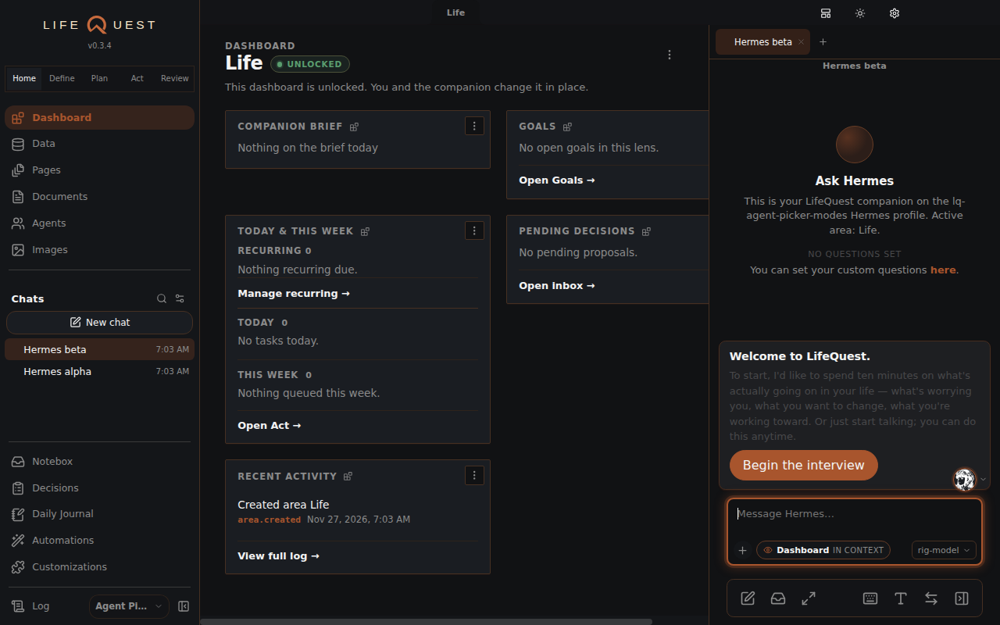
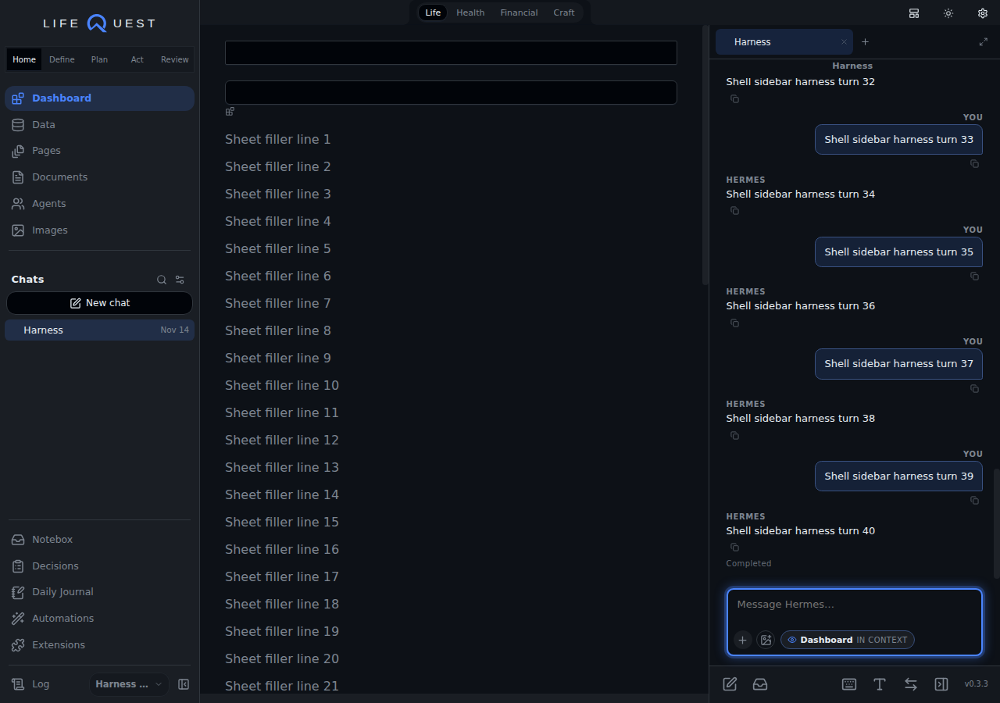
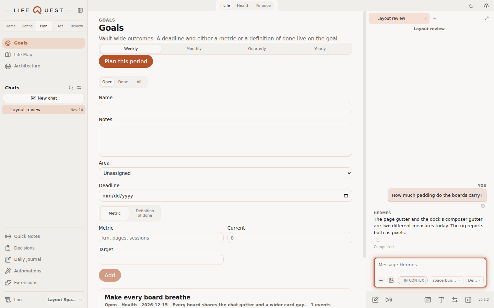
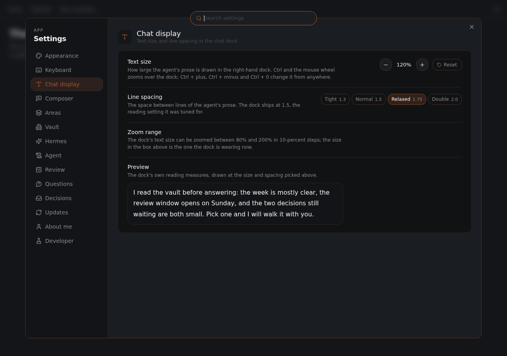
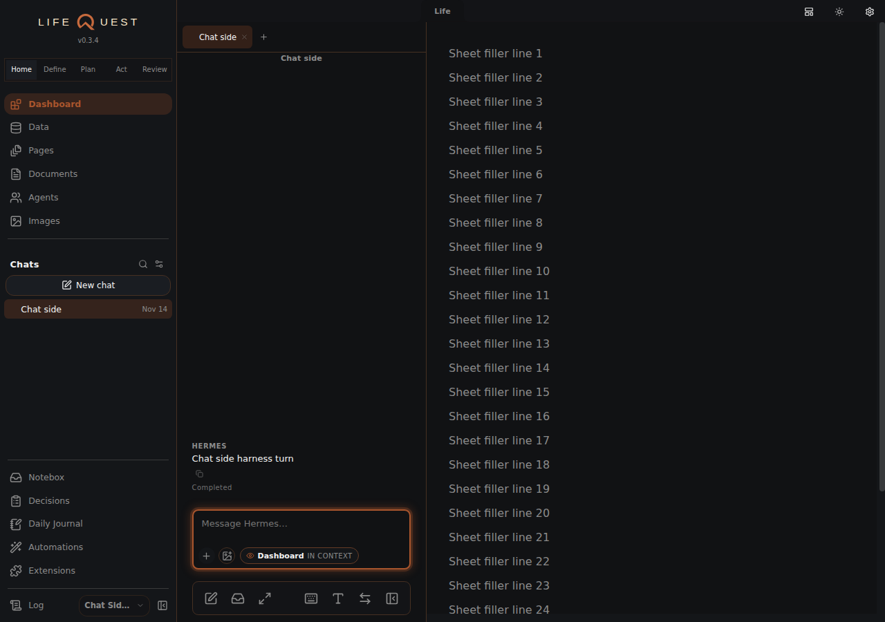
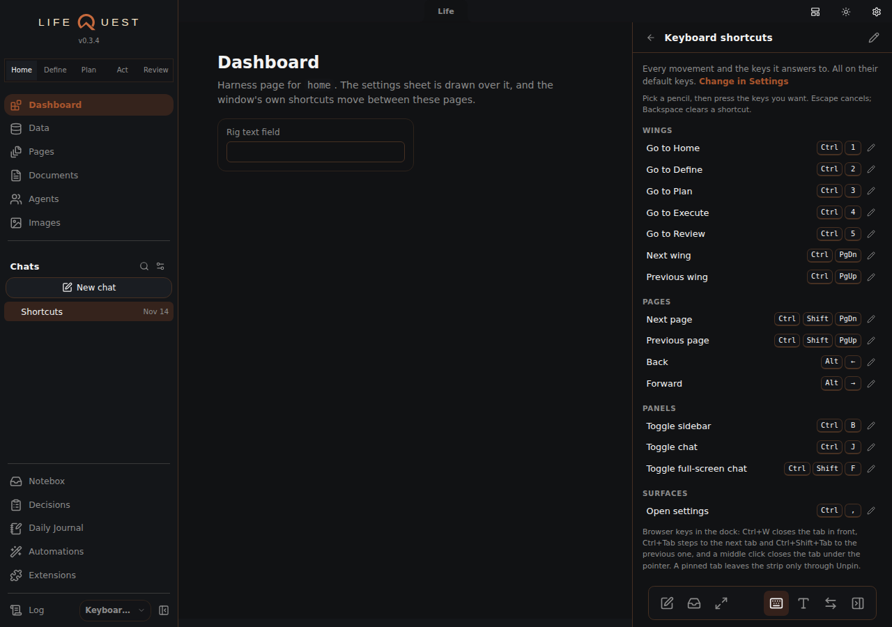

# Design System: LifeQuest

This is the normative design contract for the shipped studio. It says which names to use, what ships, and what not to do; the values themselves live in `apps/desktop/src/styles/tokens.css`. Every feature file, skin, theme file and agent adding UI follows it.

Last verified: 2026-11-27 · LifeQuest 0.3.4 · screenshots captured 2026-11-21 to 2026-11-27 from rigs run on `master`.

**Scope and sources:** `apps/desktop/src/styles/tokens.css` (all token values and the day/night blocks), `apps/desktop/src/styles/global.css` (the component CSS the values dress), the operator wiki pages [The studio](docs/wiki/03-the-studio.md) and [Customizations](docs/wiki/37-customizations.md), [PRD.md](PRD.md) for product context and [VISION.md](VISION.md) for brand personality. The contract started as [BERD systems phase 1](docs/superpowers/specs/2026-09-02-berd-systems-phase-1-design.md) and [BERD visuals phase 2](docs/superpowers/specs/2026-09-03-berd-visuals-phase-2-design.md); **BERD** is block/berd's published design contract, used here as a systems reference (layered tokens, a closed primitive menu, enforcement) plus a selected subset of its visuals (canvas/sheet ladder, concentric radii, pill buttons) — never its gray workbench, glass chrome or dot-grid.

## The vibe

**North Star: grounded life studio.** One warm paper sheet sitting on a mat, with the rail, the page and the companion's dock reading as parts of the same desk. It is quiet and dense but never cramped — the chrome is useful, the copy is plain, and the work surface stays calm enough to use every day. It is not a chatbot wrapper, a dark terminal, a metrics dashboard, a habit-tracker scoreboard, a game HUD, a marketing page in product chrome, or BERD's gray workbench.

| Do | Don't |
| --- | --- |
| Let the mat be the frame and the sheet be the work. | Wrap a pane in a second frame or add glass to the main sheet. |
| Use a semantic token for every colour. | Put hex, `rgb()` or `hsl()` in a feature file. |
| Keep chrome square where it meets the window; round controls. | Round the sheet's corners or float it as a card. |
| Use one hairline where two panes meet. | Draw the seam twice or outline every pane edge. |
| Use colour to mean state (red/green/blue/amber). | Use colour as decoration or an accent as a hover fill. |
| Let the page breathe at its own measure. | Stretch a form edge-to-edge because the monitor did. |
| Animate opacity and transform, briefly. | Animate layout, or keep scenery moving under reduced motion. |
| Show operational truth plainly. | Invent assistant-magic copy or a scoreboard flourish. |

*The studio in day mode — rail, dashboard and chat pane. Rig `agent-picker-modes.electron.mjs`, captured 2026-11-27.*

*The same shell at night in the `Nous` skin, whose declared ladder is inverted. Rig
`shell-sidebar.electron.mjs`, captured 2026-11-24.*

*A content page (Goals) showing the type and density. Rig `layout-spacing.electron.mjs`, captured 2026-11-21.*

*A Settings sheet over the studio. Rig `chat-display.electron.mjs`, captured 2026-11-26.*

*The chat pane docked on the left. Rig `chat-side.electron.mjs`, captured 2026-11-26.*

*The keyboard-shortcuts sheet over the studio. Rig `keyboard-shortcuts.electron.mjs`, captured 2026-11-26.*

## Color

**Three layers, one direction:** primitives (hex, only in `tokens.css` and skin palettes) → semantic CSS variables (shadcn-style names) → Life Quest extensions. `--bg`, `--text`, `--accent`, `--muted` and the rest are compatibility aliases only (`tokens.css:198-220`); new UI uses the semantic name. Skins write semantic and extension names onto `<html>` and must not inline alias names.

| Token | What it paints |
| --- | --- |
| `--canvas-base` | The window mat and the nav rail, which runs to the window's top edge. |
| `--background` | The page canvas: the sheet, the dock, Welcome, and the titlebar's domain tab. Aliases `--bg`. |
| `--card` | Cards, panels, menus, popovers and the composer — everything lifted off the page. |
| `--titlebar-bg` | The window's top strip (rail's trailing edge to the window edge) and the dock's bottom action row. |
| `--muted-surface` | The quiet fill; at night it is also the mat's ink. |
| `--foreground` | Primary text. |
| `--muted-foreground` | Muted text and quiet chrome; `--scrollbar-thumb` aliases it. |
| `--primary` | Brand and the accent (`--accent` aliases it). |
| `--primary-foreground` | Text on the primary fill. |
| `--accent-fill` | Hover/selected fill (never `--accent`, which stays brand). |
| `--destructive` | Dangerous acts and their text/border. |
| `--border` / `--line` | Palette hairline: card borders, inputs and pane seams. |
| `--divider` | The app's structural line only; no palette may write it. |
| `--ring` | The focus ring. |
| `--green` / `--blue` / `--amber` + `-bg` / `-border` | State colour only. |
| `--life-color` / `--icon-color` / `--uest-color` | The logo's three inks. |

**The surface ladder.** By day the mat and the panels sink below the paper, so the sheet reads as the lit surface. At night every palette inverts: the page canvas is the deepest surface in the window — the sheet, the dock, the boot pane and the titlebar's domain tab all paint `--background` — the cards and panels take `--card` and step up off it, and the mat takes the palette's quiet band, the very ink `--muted-surface` is made of. In every night skin the window's frame is one material, and nothing paints below the page. The titlebar strip and the dock's action row are the one deliberate step out of that band: both wear `--titlebar-bg`, the mat stepped halfway toward the page, so they are darker than the rail and never as dark as the page. By day the one-band rule holds — strip, rail and action row are the mat — and a skin writes `--canvas-base` from the palette background, or mixes it toward ink when background equals card; at night it is the palette's quiet band. A palette earns all of it by keeping `background` its deepest ink and giving `muted` a step above it; the mat and strip follow without a per-skin value.

**Logo inks are theme tokens, not artwork colours.** `--life-color` paints the LIFE word, `--icon-color` the Q emblem and `--uest-color` the UEST word. A skin writes all three through `forgeVarsFromColors` — Forge's night palette declares the supplied lockup inks (both words the cream `#F8E5C8`, the emblem ember `#C66A3D`; UEST keeps its own token so a theme may diverge) and every other palette derives them as foreground / primary / foreground. A theme file may override them per colour mode with `colors.logoLife`, `colors.logoIcon`, `colors.logoUest`. The sidebar and splash draw from those names only, so the mark follows the theme and can be re-inked without touching the art.

**Aliases and chrome.** `--accent` is brand (`var(--primary)`); hover fill is `--accent-fill`. `--muted` is text (`var(--muted-foreground)`); quiet fill is `--muted-surface`. `--scrollbar-thumb` is an alias of `--muted-foreground`, so a skin repaints the bar with the rest of the chrome and the brand cannot reach it.

**The divider is the app's line, not palette ink.** The sidebar's three grouping lines are `1px` of neutral gray — `#c8c8c8` by day, `#3a3a3a` at night, tuned in `--divider-width` — declared by mode in `tokens.css` (`:root`, both dark blocks) so no palette can reach it. It is painted as a `border-top`, never a background fill: Chromium snaps a used border width to whole device pixels, so all three lines paint one device pixel at 125%/150%, two at 200% and one at 100%, where a 1px fill lies on the sub-pixel grid and covers one or two rows depending on the box's position — the operator's uneven-lines report. Skins write `--border` and `--line` from their palette; nothing writes `--divider`, so Forge's ember border cannot tint the rail's groups. Pane seams keep using the palette's own border: a seam is the palette's material, a divider is the app's structure.

**ThemeProvider** may apply a named skin and light/dark/system. It must not generate a palette from one primary hex. The titlebar overlay reads `--titlebar-bg` (falling back to `--canvas-base`) and `--foreground` as hex.

| Named color rule | Contract |
| --- | --- |
| Token Contract | New UI uses semantic names. |
| Divider Standard | Sidebar group lines use `--divider`/`--divider-width`, identical in every theme within a mode; `#c8c8c8` day, `#3a3a3a` night, day lighter than night (never flatten or invert the pair); `border-top`, never a background fill; a skin never writes the divider tokens; the shell rig measures all three lines per palette and mode, in device rows at 1x and forced 125%. |
| State Color | Red/green/blue/amber mean state, not decoration. |
| Theme Provider | Named skins fill the contract; the provider never synthesizes a palette from one hex. |
| Raw Color | Hex only in primitives and palettes. |
| Dark Ladder | At night the page is darkest: sheet and dock paint `--background`, cards/panels step up, mat wears `--muted-surface`; never paint a card or the mat below the page. **Named exemption:** a faithful copy of an upstream theme may declare `darkLadder: "inverted"` and keep that theme's elevation direction; `nous` does. The mat still lifts off the page either way, and both rigs assert the declared direction rather than skipping it. |
| Palette-Only Skin | A skin carries a palette and, optionally, font stacks only — no layout, radii, motion, imagery or `[data-skin]` CSS layer. The one exception ever granted (Nous's type, orbit art, mat texture) was retired when Nous became the Hermes Desktop preset. The theme-file rule is the one surface allowed past this, and only through declared enums. |
| Scrollbar Is Chrome | Every native scroller wears the app's bar: `0.5rem`, transparent track, pill thumb quiet at rest and strengthened when its own region is hovered, then again under the pointer. Ink is `--scrollbar-thumb`; geometry is fixed at rest and on hover so strengthening cannot reflow content. A custom scrollbar follows its own region, never hover anywhere in the app. **Deliberate difference from Hermes:** Hermes hides the thumb until hover, which reads as "no scrollbar"; this app keeps the shape and keeps the bar findable. |

### Nous

`nous` is a **copy of Hermes Desktop's bundled preset** (`apps/shared/src/theme-presets.ts` in the Hermes install), where it is the product identity `DEFAULT_SKIN_NAME`; LifeQuest carries the same name and palette so a user moving between the apps sees one look. Re-import from Hermes rather than hand-editing hexes here. It is not a special skin: it is a palette and nothing else — Hermes keeps layout, sizing, radius and typography out of its palette, so `nous` ships no `[data-skin]` layer, no imagery and no second accent.

| | Nous |
| --- | --- |
| Hermes id | `nous` |
| Idea | "GitHub chrome, Nous blue accent" |
| Light | GitHub Light Default + `#0053fd` |
| Dark | GitHub Dark Default + `#4a84fe` |
| Brand blue | the accent only (`presets.ts:31-32, 65-73, 93-104`) |

Two deliberate mappings. **`background` and `card` are swapped in the light palette:** LifeQuest's mat is `background` and the sheet is `card`, while Hermes has no ladder; read straight across, Nous would paint a white rail around a grey sheet, so Hermes's page white goes in `card` and its grey sidebar in `background`. **`nous` declares `darkLadder: "inverted"`**, because GitHub Dark Default puts its cards (`#010409`) below its page (`#0d1117`); see the Dark Ladder exemption.

### Blending: OKLab, not sRGB

`mix()` lerps gamma-encoded sRGB channels and bends hue: a saturated blue mixed 88% toward white lands **~21° violet** away (`#0000f2` → `#e0e0fd`, measured) — a property of the blend, not the palette, so no palette hex fixes it. `mixOklab()` in `apps/desktop/src/lib/themes/color.ts` (ported from Hermes) walks chroma and lightness and holds hue: the same blend lands **0.3°** off. `apply-skin.ts` uses it for the blends whose ink is the brand — `--accent-tint`, the input edge and `--line`; everything else blends neutrals, where `mix` is correct.

Two reading notes: Hermes's comment says 7.6°, but that is a different reference blue — trust the rig, which measures both mixers every run. Near white the metric stops meaning anything: OKLCH chroma collapses and the hue angle of `#0053fd` at 88% is numerically unstable either way, so the rig asserts on the saturated seed `#0000f2` (where the mixers visibly part) and only reports the near-white case.

## Typography

Stacks come from `tokens.css:4-7`: `--font-sans: ui-sans-serif, system-ui, -apple-system, "Segoe UI", Roboto, Helvetica, Arial, sans-serif`; `--font-mono: ui-monospace, SFMono-Regular, Menlo, Monaco, Consolas, monospace`; `--font-display` aliases sans. No webfont is bundled.

| Role | Size / weight / line-height / tracking | Where |
| --- | --- | --- |
| Content page title | `1.5rem` / 700 / normal / `-0.02em` | `.stub-page__title`, worn by the content pages (`global.css:1865-1877`) |
| Journal page title | `1.35rem` / 700 / normal / `-0.02em` | Daily Note's date `h1`, one step under the studio title |
| Section title | `1.125rem` / 500 / normal / normal | Settings section heading (`global.css:6131`) |
| Row label | `0.875rem` / 500 / normal / normal | Settings row (`global.css:6200`) |
| Eyebrow | `0.72rem` / 700 / normal / `0.08em`, uppercase | `.wing-eyebrow`, in `--muted-foreground` (`global.css:2151-2158`) |
| Raised key label | `0.875rem` / 400 / normal / normal | The journal's `raised` act, one step under page chrome |
| Body / prose | `1rem` / 400 / `1.7` / normal | `.note-live__prose` (`global.css:2440-2444`); markdown headings use 650 / 1.3 / `-0.01em` (`global.css:2524-2531`) |

`material.typeScale` sets the root font size — `compact` 15px, `default` 16px, `airy` 17px (`theme-file.ts:27-31, 122`) — and every `rem` follows. Fixed chrome in `px` does not, which keeps a scale feeling like type rather than a zoom. **Do not set Inter or Geist as the default UI font.**

## Spacing, density and layout

| Measurement | Value | Source |
| --- | --- | --- |
| Window frame / mat | `12px` | `--shell-frame`, `tokens.css:27` |
| Top band (rail switcher, dock header) | `2.75rem` (44px) | `--shell-topbar-height`, `tokens.css:25` |
| Window strip | `32px` | `--window-titlebar-height`, `tokens.css:26` |
| Rail width | `16rem` default; `13.5` / `16` / `19rem` by theme | `tokens.css:12`; `theme-file.ts:41-45` |
| Rail collapsed | `3.5rem` icon column | `tokens.css:18` |
| Dock width | `22.5rem` default; floor `300px`, ceiling the smaller of 70% and the page's 400px; arrow step 16px | `tokens.css:28`; `chat-column.ts` |
| Page margins | `2rem` sides, `1.25rem` top, `1.5rem` bottom | `--density-pad-page-*`, `tokens.css:161-163` |
| Board gap | `1.25rem` | `--space-board-gap`, `tokens.css:167` |
| Rail padding / gap | `.35rem` / `.2rem`; row `.55rem` × `.42rem` | `tokens.css:168-171` |
| Dock padding / chat gap | `.75rem` / `.875rem` | `tokens.css:172-174` |
| Settings sheet | `72rem`, centred | `global.css:5705-5712` |
| Decisions sheet | `56rem` reading column | `global.css:5694-5698` |
| Focus sheet | `56rem` page | `global.css:5729-5733` |
| Composer gutter | `12px` per side at the 300px floor, growing to 12.5% of a wide dock | `global.css:7725-7729` |
| Settings search | `20rem` floating pill | `global.css:5893-5898` |
| Earlier-notes panel | `28rem` beside the box, box-width below it | Daily Note layout |

**The frame.** The shell is three square panes — `.nav-rail`, `.shell__main`, `.chat-panel` — on the `--shell-frame` mat. The rail wears `--canvas-base` and runs to the window's top edge in its own column; the strip above the sheet and dock wears `--titlebar-bg` and begins where the rail ends. The sheet, dock and Welcome wear `--background`. `.shell` is the grid tray, not a sheet: it has no gap, the panes abut, the sheet and dock meet the strip directly, and the frame survives only as the right and bottom slack the panes carry. The sheet's leading edge meets the rail, its trailing edge the dock's leading edge, its bottom the window's bottom, as the dock is flush right and bottom.

**Seams.** Each pane paints exactly the trailing hairline it leads into: the rail's trailing hairline is the seam with the sheet, the sheet's trailing hairline is the seam with the dock. No other edge of the sheet or rail paints a line; the strip meets the sheet as a change of tone. The sheet has no top bar — its page starts at the strip's bottom edge, reclaiming the 44px band — and the domain lens moved into the strip as the page's tab: centred between the rail's hairline and the window controls, full strip height, page ink, top corners rounded at 8px with concave fillets of the same step flaring into the page, no frame of its own, its segmented control compacted to fit (Overview, then every live domain in sort order, arrow keys included), `no-drag`, the open room on either side stays the window's drag handle, and it gives way on a narrow window rather than crowding the rail or controls. The tab exists only while the shell is mounted, so Welcome and the companion setup screen get a strip with no tab; the rail's trailing hairline is the seam at both rail widths, and the tab holds the strip's centre at both — narrowing the rail widens the drag room beside it. The dock's Notebox and shortcuts headers keep the 44px band and paint their own bottom hairline; the rail's wing-switcher band is 44px inside the rail under its taller header rather than level across the seam, and paints no line; the thread has no band — the chat name is quiet `--muted` text flush under the tab strip — the strip's own hairline is the seam — and the whole name is the rename control, with no border, fill or pencil (press to edit, blur/Enter saves, Escape cancels). The boot surfaces are that same pane flush to the window's other three edges and meeting the strip directly, with no neighbours, and the one place that draws a full box, because no neighbour's line can be the seam. The sheet is square on every corner and only it keeps `--shadow-sm`.

**Density and narrow behaviour.** Density is the material layer's spacing ladder: components read `--density-*` and `--space-*`, nothing sets its own padding, and a theme picks `compact` / `default` / `airy` (`theme-file.ts`). Ultra-wide windows grow mat around a sheet, never a wider form. The settings sheet stops at `72rem`, the decisions and focus sheets at `56rem`, and a narrow window shrinks either panel to fit. The dock is clamped by `chatColumnRange`: floor 300px, ceiling `min(70%, viewport − rail − 400px)`, arrow step 16px (`chat-column.ts`).

## Shape, elevation and surface

| Token | Step | Use |
| --- | --- | --- |
| `--radius-xs` | `6px` | Chips, dense keys, the named control exceptions |
| `--radius-sm` / `--radius` | `12px` | Settings cards, inputs, panels |
| `--radius-md` | `18px` | Larger cards |
| `--radius-lg` | `24px` | Rare large surfaces |
| `--radius-pill` | `999px` | Buttons, toggles, scrollbar thumb |

`material.radius` chooses one declared scale, never an arbitrary radius: `sharp` 2/4/4/6/8, `soft` 6/12/12/18/24, `round` 12/16/16/22/28, written through the `--radius-*` variables (`theme-file.ts:15-18`). The Calm Scale's base is `6 / 12 / 18 / 24 / pill`; do not change the type scale here.

| Shadow | Use |
| --- | --- |
| `--shadow-xs` | Barely-there lift |
| `--shadow-sm` | The sheet and ordinary raised surfaces — the general ceiling |
| `--shadow-md` | Floating menus/popovers, and the raised key's lift (`global.css:2792`, `:180`) |
| `--shadow-card` | The Decisions inbox card only |
| `--shadow-nous` | Nous's own layered shadow |

**Flat First:** canvas vs sheet is the elevation ladder; do not add shadows beyond `--shadow-sm` on the sheet; `material.shadow` and `material.motion` restate the elevation and timing tokens, mixed from the palette's own ink rather than baked black. **Named exemption — the Decisions inbox cards** (`.decision-card`): the one surface standing proud of the sheet, because the operator answers them one at a time; each wears a neutral grey step, `--shadow-card`, the hover slash, and runs tighter than a page card (three-line rationale, `8rem` cap on proposal prose, compact field rows). **Named exemption — the `raised` Button** (`.btn-raised`): it lifts the Daily Note's own act off the page with a face, bevel and lip, because that control commits the prose under it; every other control stays on the flat ladder.

- **One Frame Per Card:** a card draws its own shell and its container adds none; a wrapper carries layout markers only (`.view-card--span2`). Nesting the card class gives a frame inside a frame on every view pin.
- **One Box:** markdown is `LiveMarkdownEditor`, one surface where the file renders and the paragraph under the caret does not. Never add a second pane beside it: two surfaces showing the same file can disagree about it.
- **Closed Primitive:** extend `Button` / the settings primitives; do not restyle in features.

## Motion

| Token | Value |
| --- | --- |
| `--ease-out` | `cubic-bezier(0.23, 1, 0.32, 1)` (`tokens.css:183`) |
| `--dur-quick` | `120ms` |
| `--dur-enter` | `200ms` |
| `--dur-exit` | `140ms` |

`material.motion` is a closed enum — `none` / `calm` / `lively` — and uses the bundled timings only; a theme cannot name its own duration or easing. Animate opacity and transform only; never layout. Scenes freeze under `prefers-reduced-motion` — `SheetOverlay` also drops its 140ms exit wait and leaves immediately (`SheetOverlay.tsx:15-20, 80-84`). The R4 ring has nothing to animate, and `Tab` visits every action in drawn order. A composition's grid and polar layouts ship with their own keyboard and reduced-motion story.

## Iconography and marks

**The lockup** is the active one of four shipped logos (`src/assets/brand/logo/`, default **Minimal**, picked on Settings → Developer), drawn inline so its three inks follow the theme (Color, above). It is sized to one lockup row (`1.7rem`), takes its width from the art's aspect, and is drawn from an ink-tight viewBox so the painted mark — not the supplied canvas's margins — is what the header centres. The supplied art's two short rules flanking the words are present in the files but not drawn: the mark reads `LIFE · Q · UEST`, no dashes, everywhere. The words are drawn at about half the emblem's height. The thin rail leaves the lockup and build number out — 56px cannot hold a word — moves the square collapse control into the topband as the pure Q emblem, and keeps the Log icon and vault initials in the foot.

**Agent marks** (`AgentMark.tsx`) are the agent's block: artwork as an image or a black-and-white glyph in the theme's ink (`currentColor`), with the agent's initial as fallback so a harness never arrives invisible. The block's control names the agent, so the image carries `alt=""` and the glyph is `aria-hidden`.

**The icon set is not bundled.** Phase 1 cut a bundled icon set from R1, and the app ships [lucide-react](https://lucide.dev) `^0.511.0` as inline SVG React components instead. Sizes are chosen inline, 11–20px in the shipped code. No icon size or grid token exists; **not specified — match the 16px rows**, and treat this as an open gap rather than a law.

## Components and primitives

The shared primitives live in `apps/desktop/src/components/ui/`; features use them and do not restyle them. No raw hex in that folder or in feature CSS.

**Button** (`.btn`) — variants `primary`, `outline`, `ghost`, `raised`, plus `destructive` (maps to `.btn-danger`). Pills via `.btn`, links via `to` (renders `Link`), no Radix. Three named radius exceptions exist and only these: the **journal's page** (`.daily-note` wears `.btn` at `--radius-xs`; a row of pills around prose reads as chips — the override lives in `notes.css`, and `.data-studio` / `.pages-studio` square their own controls the same way), a **settings row's control** (`.settings-card__control .btn`, `--radius-sm`, scoped in `global.css`), and the **Decisions card's answers** (`--radius-xs`, larger padding than default). The **`raised`** exception is the journal's own act, its manual automations (`Analyze note` first among them): the accent sunk into the page, lit top edge, hard lip, `--radius-xs`, label `0.875rem`, a shorter block padding so it sits under the title row's keys, at the box's foot on its trailing edge level with the autosave line, one step under page chrome; the look lives in the primitive and the token file, so a feature file still restyles no button, and any surface that later asks for the same act wears the same key.

**Toggle** (`.ui-toggle`) — the on/off bit whose change takes effect the moment it flips (arming a destructive restore). It is a `role="switch"` button, not a checkbox: a checkbox says "include this in the set" and is read on submit. No caption by default because the row's label names it; pass one where the switch stands beside a name that does not describe it (the Books rows' `Allow restore`). Track stays `--radius-pill`; the Books rows wear the larger `--toggle-*` step.

**SettingsSection / SettingsRow** — own the settings heading and row chrome; cards use `--radius-sm`. A row is a flex pair: label and description leading, control trailing, a real gap, a hairline between rows. Never stack them — copy pressed against the control is the layout this prevents. `note` sits under the copy, not loose in the card. `SegmentedControl`'s `sm` size is the settings-row size so a row stays one line; `ListRow` is the plain label/description/action row; `SettingsFact` is the label/value fact.

**Settings sheet** — a workbench at `72rem` centred in the scrim; an ultra-wide monitor gets mat on both sides, not more form, and the nav keeps its column and the page keeps its line. No title band: the cross is pinned over the page's top-right padding and takes no layout height. The search is the one pill-shaped field: `20rem`, centred, with the panel's top border running through its horizontal axis — half in the sheet, half over the scrim — because it has no panel corner to agree with. Only the search crosses that edge; everything else stays inside, and the section nav and page start at the panel's top edge immediately under the floating bar.

**Cards and ViewCard** — `ViewCard` is the one drawing path for the home pin board and a page's view-ref block: one card may hold several blocks under one title, drawn in order in inline SVG with theme tokens, no chart library. Every read is a dependency of the run that makes it, so a vault write, a Decision approval or the day turning re-runs it. Its edit control changes only `presentation` and saves the same card in place; it must not retarget the query. A locked page disables it for operator and agent alike.

**PageMenu** — every lockable page's actions behind one three-dot trigger, with the page lock as the first item (`menuitemcheckbox`). The popover is anchored right-aligned, portalled, mounted only while open; actions close it and return focus to the trigger before running. **ConfirmDialog** is the app's own confirmation, portalled to `body` (a fixed backdrop inside a pane is trapped in that pane's stack), `role="dialog"`, `aria-modal`, Escape and scrim-click cancel, and Cancel takes initial focus so a stray Enter cannot confirm.

**Sheets, including focus mode** — `SheetOverlay` is the shared frame (settings, decisions, focus): the window dims and blurs behind a portalled panel, three ways out (cross, scrim, Escape), a focus trap and `aria-modal` promised into being, and the exit motion deferred 140ms before the route changes. Each sheet caps its own measure; a window wider than the measure grows mat around it. **Focus mode** is the Daily Note's page at `56rem`: the page behind is blurred harder (texture, not context), its chrome is nothing — no title band, no subtitle, no pager — and the cross is pinned top-right so it does not push the heading off centre. The day's date is the page's one `h1`, centred over the prose; the sheet title is not removed but hidden and still labels the dialog for a screen reader, because a page headed twice is a page with two names. The autosave band is always mounted and reserves its height, so "Saving…" arrives where space already was, and the day's acts (Analyze note first) sit at the foot, not in window chrome. The note box takes the sheet's remaining height under the heading, and a long day scrolls inside it while the heading stays put.

**LiveMarkdownEditor** (`.note-live`) — the studio's one markdown surface. Every editor that writes markdown (daily note, doctrine document, review) is this box: the file reads as prose and the block under the caret is its raw markdown, in place, one blank line between blocks, and blank lines are the operator's. A locked document renders the same box read-only with no writing line. There is no split editor and no preview pane.

**The journal's page** is headed by the day, not its own name: the date is the one `h1`, centred over the prose at `1.35rem`/700/`-0.02em`; `Daily Journal` steps to the shell's one grey page-name eyebrow (`.wing-eyebrow`), because the journal belongs to no wing but its name is the same grey the shell gives a page name. The page's keys sit at the trailing end of the title row in the order they happen: the shortcut back to today (only on a day that is not today), then focus mode, a square framed `outline` key with no word whose two dimensions are both `--daily-note-act-height` so it stands exactly as tall as the title row (the square is expressed, not derived: a flex item resolves its main size before a stretch lands, so a square taken from a stretched neighbour is a rectangle). The act that commits the note is not among them: it sits at the box's foot on its trailing edge, level with the autosave line that says whether the prose reached the vault. The day row is three declared tracks with the outer two equal, so the day stays on the box's centre. Its steps are keys, not buttons — a chevron and no frame at all, because a day back or forward is the one thing the shapes say — and the forward key is drawn only when there is a day to go to: the future is closed, so on today it is absent, not disabled and greyed. A calendar key beside the day opens a month in the quick menus' portalled popover — Monday first, the week the Life Map draws — offering only days that have happened; the month arrows stop at the month today is in, and a future day is drawn inert rather than refusing on press, so the edge is visible rather than discovered.

**The Earlier notes index** is a navigation panel, not a table floating under the page: one framed block on the card ladder (`--card` surface, `--border` hairline, `--radius-sm`) with a name band (`Earlier notes` plus the note count) and the file tree's two shapes — a folder row per week (this week open as `This week` with no toggle, older weeks as their own fold) and a file row per day, with a file that names no usable day in its own group. Rows are a step below the prose (`0.72rem` under an `0.82rem` heading and a `0.6rem` column header) because the index is skimmed; the three columns (Date, Day, Last edited) stay aligned between header, files and the unreadable row. A day's name cell is indented one tree step under its week's glyph; Day and Last edited keep the header's x. In the two-column layout the panel takes a sidebar's measure (`28rem`) beside the box; under the box it keeps the box's width so the page reads as one column with chrome below it.

**The studio shell** — three square panes on the mat, as described under Spacing. The rail's header starts at the strip's top edge (the leading corner stays the drag handle), carries the lockup and build number, both inset one rail-content step. The collapse toggle holds the trailing end of the foot row beside the vault chip, and the lockup is the second door to the same collapse (the mark alone is `no-drag`; its only hover cue is the pointer — no fill, no tooltip). Collapsing narrows the rail to its icon column instead of removing it: the pane stays, the toggle turns around, page rows keep icons/counts/names, the governed shelf and foot stay, and the five-wing switcher turns vertical above the active wing's rows. In the wide rail the foot is one row: the Log closes the navigation, the vault chip names the open vault, and the collapse toggle holds the trailing corner immediately right of the chip. Thin, the Log's icon and the chip's initials stack; the chats list leaves the column, the version line (its own container) retires, the inline "Update available" words retire in a narrow rail so they cannot squeeze the number out, and the square toggle moves up from the foot into the topband as the pure Q emblem, where a press reopens the rail; that thin header row is also the drag handle and the column's top air. The titlebar carries no vault chip; its open room is the drag handle, broken once by the centred domain tab, and the tab holds the strip's centre at both rail widths. The wing switcher is a square block with no corner radius, its frame inside the rail's padding; the selected wing wears the raised fill and its shadow, never a second nested hairline. Feature files must not add a second frame or extra glass.

**The dock** — the composer is a column inside the dock, not its full width: its band leaves `--composer-gutter` empty on each side (`12px` at the 300px floor, growing to 12.5% of a wide dock), so a wider dock gives a centred composer, not a stretched field. The transcript keeps that measure and reserves its scrollbar outside it at the dock's edge. The agent switcher stands in the trailing gutter, level with the composer's bottom; when the dock is too narrow it steps above the composer over the transcript's bottom-right, and it follows the composer out of sight on the shortcuts reference. The bottom action bar is a card at the composer's shipped width rather than a band across the dock, centred and capped by the field at the floor (`--dock-actions-width`, `global.css:7738, 9309-9318`). The tray's last two panes trade places: the action bar's switch-position control (immediately left of collapse) swaps the dock's column for the sheet's (`.shell--chat-left`), one click each way. The rail never moves — it is the window's chrome, not a tray pane — so the dock sits just past it and the sheet takes the trailing column plus the frame slack. Each pane owns its content, the sheet paints the seam only on the edge facing the dock and stays square everywhere; the swap is session state like the rail's collapse, not a stored preference. The composer's width is the dock's own business — no other pane may claim a share of it.

## Accessibility

- **Contrast:** every text pair in a theme palette passes WCAG AA (4.5:1); the failing pair and its ratio are named at validation. The in-app fields editor checks live and names every failing pair.
- **Keyboard:** every control is reachable and operable from the keyboard, including the composition ring (plain tabbable links, drawn order), rail rows, menus and dialogs. Menus return focus to their trigger; dialogs keep a focus trap.
- **Dialogs:** `role="dialog"`, `aria-modal="true"`, and a title that labels the dialog — even when visually hidden (focus mode hides the sheet title but keeps it for screen readers).
- **Motion:** honour `prefers-reduced-motion`; scenes hold still and the sheet leaves without its exit wait.
- **Focus:** the ring is `2px solid var(--ring)` (`global.css:2447` and most focus-visible rules); home pins use `--accent` for their own ring (`global.css:4981`). No ring width/offset tokens exist — an open gap; use the 2px `--ring` outline and do not remove it.
- **Target size:** no target-size token or minimum is specified — an open gap. Do not shrink a control below its row: the 44px band is chrome height, not a target-size law.

## Do not do

- Do not add dot-grid, `PageShell`, or a pill composer.
- Do not set Inter or Geist as the default UI font.
- Do not reclaim `--accent` as a hover fill (hover is `--accent-fill`).
- Do not add a second canvas frame, extra glass (including glass on main), or a second frame around a card.
- Do not add a second editor pane beside markdown.
- Do not put raw hex, `rgb()` or `hsl()` in a feature file (primitives and palettes only).
- Do not round the sheet or turn panes into cards; corners are square where pane meets window.
- Do not paint a card or the mat below the page at night.
- Do not paint the sidebar divider with `--border`, as a background fill, or from a skin.
- Do not let a theme file ship code, CSS, scripts, arbitrary layout, markup, imagery, a shader or a stylesheet; it names declared enums only, and at most references a picture already in the profile's `backgrounds/`.
- Do not hide the way out: window controls, the Settings entry and the preview bar are outside every theme.
- Do not make LifeQuest feel like a chatbot wrapper, dark terminal, metrics dashboard, marketing site, habit-tracker scoreboard, game HUD, or BERD's gray workbench.

## Appendix: Theme File v2, R4 composition, history

**Theme File v2.** A theme file is data, never code: JSON in the app profile's `themes/` directory (**never** the vault, so no Decision and no migration). It may carry a complete palette (which must pass WCAG AA on every text pair, the failing pair named), with logo inks as optional `logoLife`/`logoIcon`/`logoUest` on either colour mode; a `chrome` block moving the wing switcher between `rail-top`/`titlebar-left`/`floating-left`/`hidden` (variants `labels`/`icons`/`compact`), the area lens between `titlebar-center`/`left-rail`/`below-titlebar`/`bottom-center`/`floating-bottom-right`/`hidden` (variants `segmented`/`pill`/`icons`/`list`), the sidebar width between `narrow`/`default`/`wide`, its place between `left`/`right`/`floating` (a card above the page), the dock side between `left`/`right`, and the strip height between `compact`/`default`/`tall` (on platforms that draw their own caption strip, `compact` floors at the platform's height — never paint under the OS buttons); a `material` block picking named steps on six axes — radius (`sharp`/`soft`/`round`), elevation (`flat`/`soft`/`deep`), type scale (`compact`/`default`/`airy`, on the document root), density (`compact`/`default`/`airy`, restating the shell's spacing ladder — page margins, rail rows, dock transcript; nothing sets its own padding), motion (`none`/`calm`/`lively`, bundled timings only) and canvas backdrop (`plain`/`wash`/`grid`, the latter two procedural gradients, never imagery); and a `scene` block naming a bundled procedural backdrop plus how lively it runs (`calm`/`default`/`lively`). The scene is the app's drawing, not the theme's: behind the page under a palette scrim, at most ninety nodes, opacity/transform only, dead still under reduced motion — a theme names a sky, never ships an image, shader or stylesheet. It also names a page-edge frame (`none`/`hairline`/`double`/`halo`) and a card treatment (`theme`/`outline`/`raised`), both drawn by the stylesheet from palette and radius tokens, floating over content without taking a control's target (the edge is `pointer-events: none`), gone with the theme. The operator can override any material axis and chrome pick in Settings → Appearance; an operator pick wins and survives keep/revert/remove. A theme can hide a switcher but never the way out: window controls, the Settings entry and the preview bar are outside every theme. Full-screen chat is shell state, not theme data, and composes with every rail placement (floating rail: dock starts at the card's trailing edge and carries frame slack to the glass; rail right: dock takes the leading track and meets the rail's edge); leaving restores the rail and dock boxes. The layouts picker is shell state on the same terms — studio, split with page/agent leading, or agent alone — measured from the rail's trailing edge to the glass so it stays a half each when window or rail width changes; its full-agent card writes that mode rather than a lookalike, the mode lies over whatever arrangement is on screen, and leaving restores the split or studio boxes. A new/changed file is worn ten seconds, then kept only by the operator's Keep (or reverted). No CSS, scripts, arbitrary layout or imagery. The app bundles five showcase themes (`showcase-solar-system`, `showcase-helios`, `showcase-paper-trail`, `showcase-night-shift`, `showcase-control-room` in `shared/showcase-themes.ts`) copied into a fresh profile before the first window; they are the same data an operator or companion could write — palettes in both modes, chrome placements, material steps, scenes and compositions — and none is worn implicitly: each waits in Theme files for Try and carries a Gallery chip. Solar System and Helios are the R3/R4 examples (the dark-orbit sky with a haloed page and raised cards; the warm solar HUD with a `polar` ring of quick actions and two counts); Paper Trail, Night Shift and Control Room show the corners between rungs as whole files. Seeding is versioned: `theme-state.json` carries `seededShowcase: string[]`; boot writes each missing bundled name with `wx` (never overwriting an operator file), records it and persists; a legacy `showcaseSeeded: true` reads as the two names that existed then; a recorded name is never re-added, while an existing profile still receives the three new examples. The in-app workshop is the Extensions page (`/extensions`, the rail row under Automations): create from blank or the active look, edit JSON with live validation against the same shared rules, save through main's parse-and-write gate (atomic; a refusal names the field), switch the active file on/off like an extension, and remove it. **Fields** authors the look visually: composition (five regions, eight widget types, three layouts), chrome, material (six axes), scene (backdrop, intensity, page edge, card frame) and palette (both `colors` and `darkColors` complete when present, WCAG AA live at 4.5:1 with every failing pair and ratio named, per-palette include toggles handing a half back to the skin, Copy current palette seeding from the window's look); every change is a draft never written, kept or previewed — Cancel hands the kept look back, Save runs the same parser and gate as the JSON tab, which stays one press away and shows the draft's serialised bytes. The studio reuses Settings' controls in controlled mode; Settings keeps its override layer unchanged and the two are not unified. Each save keeps the newest ten snapshots in `theme-history/<stem>/` (outside `themes/`, never listed/worn/previewed); **Restore** re-validates and writes back through the same gate, an undo that is itself undoable. **Import** brings one JSON through a main-process picker, same parser and gate: named from the theme's slug, never overwriting (`-imported`, `-imported-2`, …), previewing rather than keeping. The Settings list stays the quick Try/Keep/Remove view; neither surface writes anything main has not parsed.

**R4 composition (spike).** Grid and polar layouts place **1–8** widgets from a closed vocabulary (`badge`/`meter`/`quickAction`/`avatar`/`list`/`clock`/`calendar`/`brief`) on closed regions (`page.masthead`/`page.footer`/`page.orbit`/`rail.top`/`rail.footer`); `page.orbit` only with `polar`. Badges/meters/briefs bind only to counts the shell holds (`domains.count`, `agents.count`, `decisions.count`, `goals.count`, `reviews.count`, `weekly.files`); `avatar`/`list`/`calendar` bind to closed text/date shapes (`vault.name`, `domains.names`, `goals.titles`, this week); a `quickAction` points only at an app route (`home`/`goals`/`projects`/`data`/`notes`/`automations`); tone is a family (`accent`/`muted`/`success`/`warning`), never a colour. Layout is `stack`, `grid` (`columns` 2 or 3) or `polar` (deterministic ring, top first and clockwise, actions plain tabbable links). A widget's label is the only author-written word (≤ 32 chars, no markup). The parser names the failing field; the validator gates it; grid and polar ship with their keyboard/reduced-motion story. The renderer draws inside named regions only, so a composition can never draw chrome, a Decision, a control outside theme reach, arbitrary CSS/markup/imagery, a URL, or data outside the list. Operator override is one axis (wear the theme's widgets or hide them); Reset hands composition back to the theme. **R4 gate:** the same rig proves it end to end — a bundled `showcase-helios` seeded into a fresh profile, a companion-authored Helios written through the MCP door and worn as a preview, the operator hiding/restoring its ring from Settings, Keep surviving a window reload, and a spoofed widget refused at the door by name before any file exists.

**Boundaries and history.** Phase 1 (R0 palette; R1 radius, elevation, type scale, density, motion, backdrop; R2 wing/domain placement and variant, rail place/width, dock side, strip height) is first-class data-only theming; R3 made the scene layer first-class data-only too: four procedural backdrops (`plain`/`starfield`/`orbit`/`aurora`) with an intensity that only spends motion, plus a page-edge frame (`none`/`hairline`/`double`/`halo`) and a card treatment (`theme`/`outline`/`raised`). The app draws all of it (bounded nodes, opacity/transform only, dead still under reduced motion, behind a palette scrim); the operator can override every part and Reset hands the theme's sky back; a bundled `showcase-solar-system` is seeded into a fresh profile once and worn only by the operator's Try. The R3 gate: a companion-authored aurora theme worn from outside, quieted by the operator, restored by Reset, kept across a reload, with the way out still painted. A border family and a bundled icon set were cut from R1 under the audit budget. The current scene schema ships six procedural backdrops — `plain`, `starfield`, `orbit`, `aurora`, `horizon`, `mesh` (`shared/theme-file.ts:269-276`) — and `ThemeScene` also allows a reference to a picture already stored in the profile's `backgrounds/` (`shared/theme-file.ts:155-160`); a theme still cannot ship an image, canvas or shader. The regression history behind these rules: the sRGB `mix()` that turned a clean blue accent into a lavender selected row, lilac chip border and periwinkle mat (fixed by `mixOklab`); the 125% Windows display's uneven sidebar lines (fixed by `border-top`); the operator's reports that pills around the journal's prose and beside its settings rows read as chips (fixed by the radius exceptions); and the retirement of Nous's type/orbit/texture treatment when the preset became palette-only.
